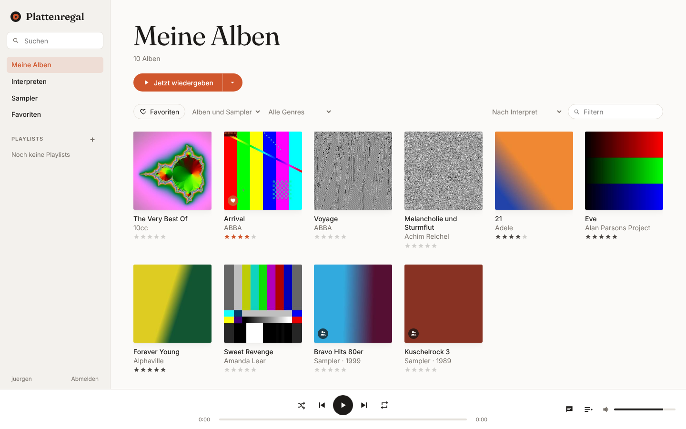
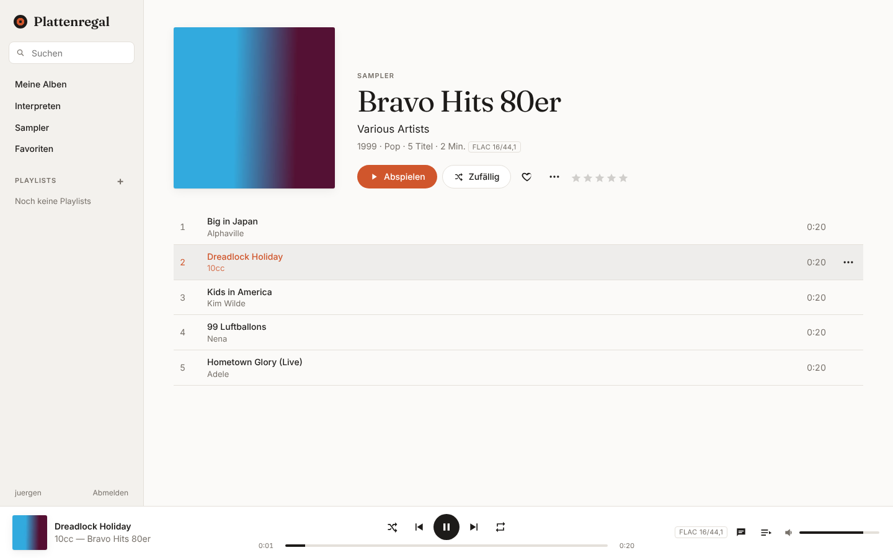
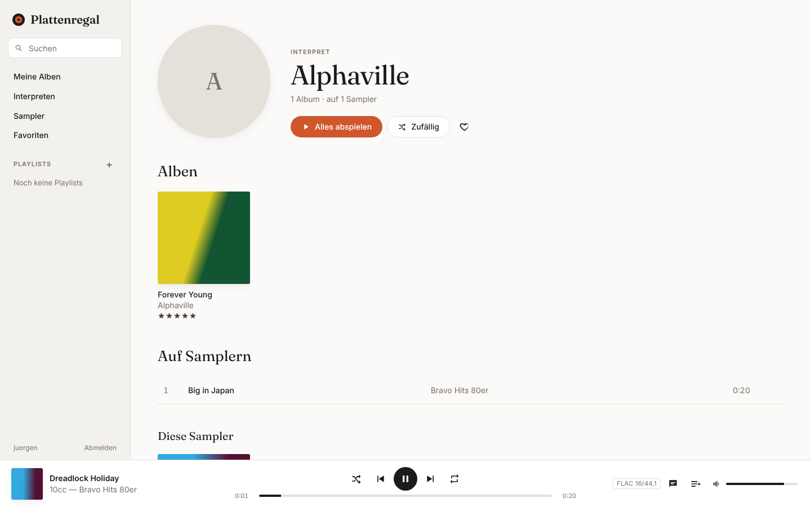
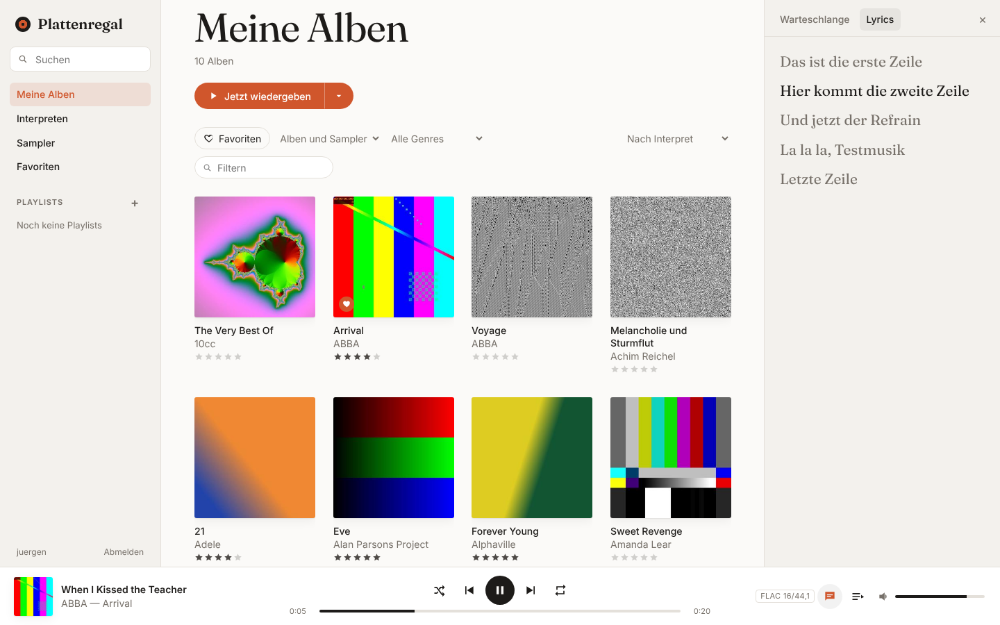
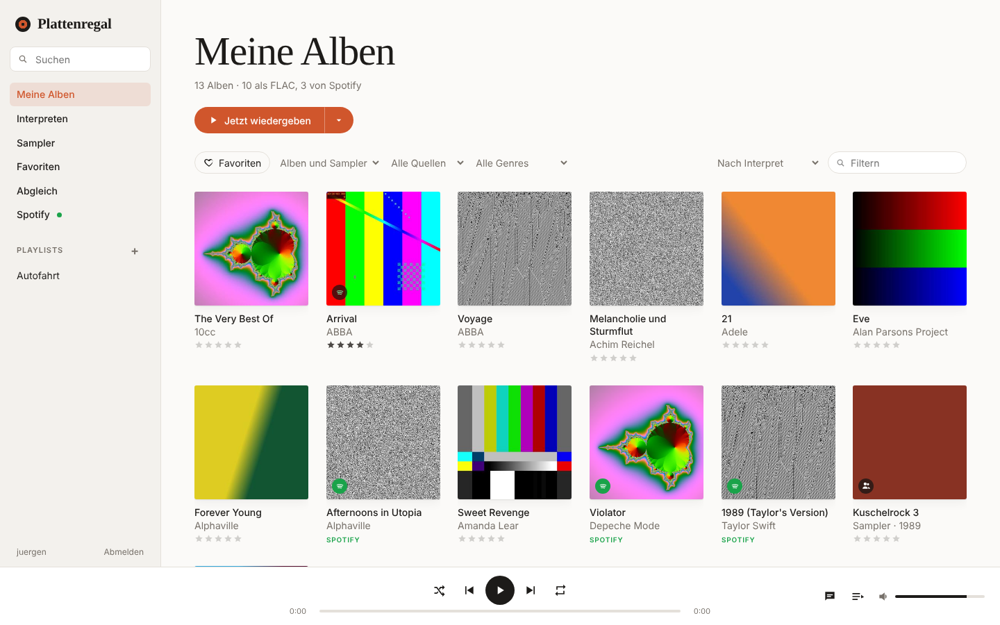
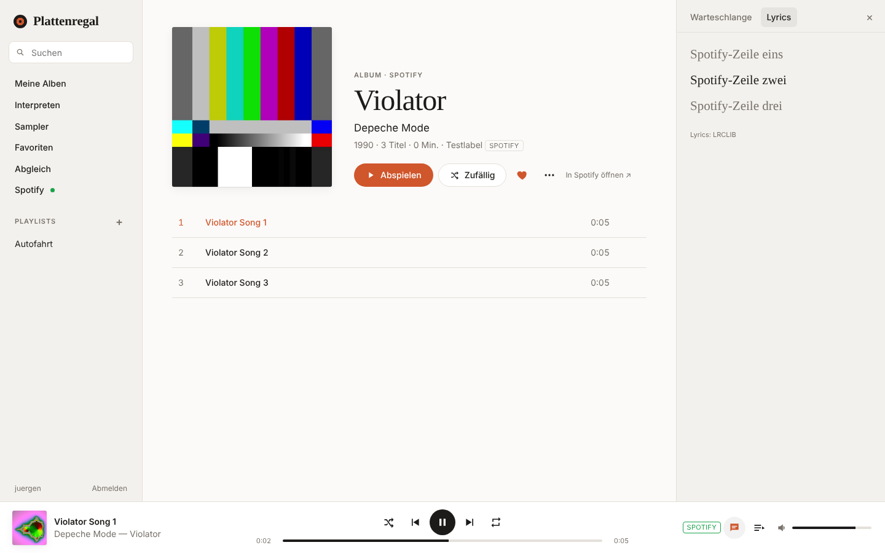
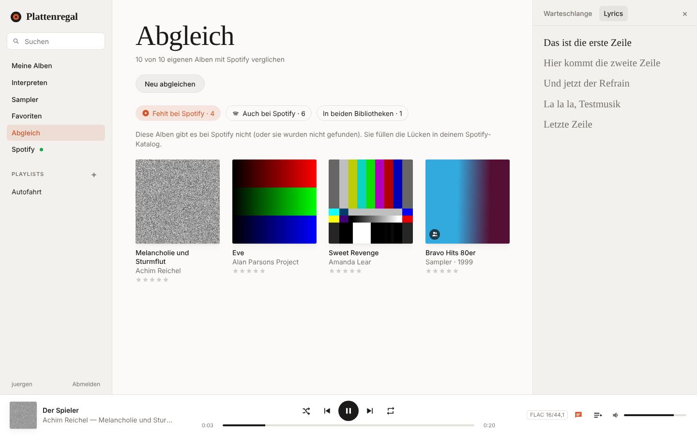

# Plattenregal

Eine eigene Oberfläche für deine FLAC-Sammlung auf dem Linux-Homeserver: Cover-Raster, Sampler-Ansicht, Interpreten, Playlists, Lyrics und Wiedergabe direkt im Browser in voller FLAC-Qualität.

## So ist es aufgebaut

```
Laptop (Browser)  ──►  https://SERVER:8443 (Caddy, für Spotify) / http://SERVER:8080
                                │
                                ▼
                         nginx (Plattenregal-Oberfläche)   ◄──►  Spotify (Web API + Player, direkt aus dem Browser)
                                                   │  /rest/…
                                                   ▼
                                                Navidrome (Musikserver, liest /music nur lesend)
                                                   │
                                                   ▼
                                                deine FLAC-Ordner
```

* **Navidrome** (Open Source) übernimmt das Einlesen der Tags und Cover, die Datenbank, Bewertungen, Favoriten, Playlists und Lyrics. Es scannt neue Alben stündlich und bemerkt Änderungen im Ordner sofort.
* **Plattenregal** ist die eigene Oberfläche davor. Sie spricht mit Navidrome über die offene Subsonic-Schnittstelle. Dazu kommt Spotify (siehe unten).
* Deine Musikdateien werden **nur gelesen**, nie verändert.

## Installation auf dem Linux-Server

Voraussetzung: Docker mit dem Compose-Plugin (`docker compose version` sollte eine Version zeigen).

1. Das Repo auf den Server holen:
   ```bash
   git clone https://github.com/tobyyy1969-collab/platten.git ~/plattenregal
   ```
   (Da das Repo privat ist, fragt git nach deinem GitHub-Namen und einem Zugriffstoken als Passwort.)
2. Einstellungen anlegen:
   ```bash
   cd ~/plattenregal
   cp .env.example .env
   nano .env        # MUSIC_DIR auf deinen Musikordner setzen, PUID/PGID mit "id -u" und "id -g" prüfen
   ```
3. Starten:
   ```bash
   docker compose up -d
   ```
4. Im Browser am Laptop **http://SERVER-IP:4533** öffnen (Navidrome) und den ersten Benutzer anlegen. Dieser wird Administrator. Der erste Scan läuft automatisch; bei ca. 1.000 Alben dauert er einige Minuten.
5. Dann **http://SERVER-IP:8080** öffnen und mit demselben Benutzer anmelden. Fertig.

Aktualisieren: `git pull && docker compose pull && docker compose up -d`. Stoppen: `docker compose down`.

## Was die Oberfläche kann

| Bereich | Funktionen |
|---|---|
| **Meine Alben** | Cover-Raster, Sortierung nach Interpret, Titel, Jahr, zuletzt hinzugefügt, Bewertung, zuletzt gespielt. Filter nach Text, Genre, Favoriten und „mit / ohne / nur Sampler“. „Jetzt wiedergeben“ spielt einen Zufallsmix aus der aktuellen Ansicht. |
| **Album** | Großes Cover (anklickbar), Titelliste mit CD-Trennung, Format (z. B. FLAC 16/44,1), Bewertung, Favorit, Abspielen, Zufällig, Als Nächstes, Warteschlange, zu Playlist. |
| **Sampler** | Eigene Ansicht. Auf Samplern steht bei jedem Titel der Interpret, verlinkt auf seine Seite. |
| **Interpreten** | Alphabetisch mit Sprungleiste. Optional auch Interpreten, die nur auf Samplern vorkommen. Die Interpretenseite zeigt eigene Alben **und „Auf Samplern“** mit genau den Titeln dieses Interpreten. |
| **Playlists** | Anlegen, Titel oder ganze Alben hinzufügen, entfernen, umbenennen, löschen. Sie liegen in Navidrome und gelten damit auch in anderen Subsonic-Apps. |
| **Lyrics** | Rechtes Seitenfenster. Synchronisierte Lyrics laufen mit und lassen sich anklicken, um zu springen. |
| **Player** | Zufall, Wiederholen (alle / einen), Warteschlange, Lautstärke, Medientasten der Tastatur. Leertaste = Pause, Shift+Pfeil = Titel vor/zurück, `/` = Suche. |

Hell- und Dunkelmodus folgen der Einstellung deines Laptops.

## Wie deine Tags genutzt werden

* **Sampler** werden erkannt, wenn `COMPILATION=1` gesetzt ist oder der Album-Interpret „Various Artists“ heißt (MusicBrainz Picard macht beides automatisch).
* **Cover**: eingebettet oder als `cover.jpg` / `folder.jpg` im Albumordner.
* **Lyrics**: aus dem Tag `LYRICS` (gern im LRC-Format mit Zeitmarken) oder aus einer `.lrc`-Datei mit gleichem Namen neben der FLAC-Datei.
* **Mehrere CDs**: über `DISCNUMBER`.
* **Künstlerfotos** holt Navidrome automatisch aus dem Netz (Deezer). Mit einem Last.fm-Schlüssel in `.env` kommen Biografien dazu.

Wenn ein Album falsch einsortiert ist, Tags korrigieren. Navidrome bemerkt die Änderung von selbst.

## Spotify einbinden

Deine gespeicherten Spotify-Alben erscheinen zusammen mit deinen FLACs in „Meine Alben“. Gibt es ein Album in beiden, wird es nur einmal gezeigt und deine FLAC abgespielt. Spotify-Titel laufen direkt im Browser über den offiziellen Spotify-Player (Premium nötig).

**Warum HTTPS?** Spotify erlaubt Anmeldung und Wiedergabe nur über eine HTTPS-Adresse. Dafür startet `docker compose` zusätzlich einen kleinen Caddy-Server mit eigenem Zertifikat. Mit Spotify öffnest du Plattenregal deshalb unter **https://SERVER-IP:8443** statt unter http://SERVER-IP:8080.

### Einrichtung (einmalig, ca. 10 Minuten)

1. In der Datei `.env` auf dem Server `SERVER_ADDRESS` auf die Adresse des Servers im Heimnetz setzen (z. B. `192.168.178.20`), dann `docker compose up -d`.
2. **Zertifikat auf dem Mac vertrauen**, damit der Browser nicht warnt:
   ```bash
   # auf dem Server: Zertifikat in den Plattenregal-Ordner kopieren
   cp ~/plattenregal/data/caddy/caddy/pki/authorities/local/root.crt ~/plattenregal-root.crt
   ```
   Die Datei auf den Mac holen (z. B. per `scp`), doppelklicken, in der Schlüsselbundverwaltung auf „Caddy Local Authority“ doppelklicken und unter „Vertrauen“ **Immer vertrauen** wählen. Danach den Browser neu starten.
3. **Spotify-App anlegen** auf [developer.spotify.com/dashboard](https://developer.spotify.com/dashboard): „Create app“, Name z. B. „Plattenregal“, bei den APIs **Web API** und **Web Playback SDK** ankreuzen. Als **Redirect URI** genau `https://SERVER-IP:8443/` eintragen (mit Schrägstrich am Ende).
4. Die **Client ID** der App entweder in `.env` als `SPOTIFY_CLIENT_ID` eintragen (dann `docker compose up -d`) oder direkt in Plattenregal auf der Seite **Spotify** einfügen.
5. In Plattenregal unter **Spotify** auf „Mit Spotify verbinden“ klicken und bei Spotify zustimmen.

### Was dazukommt

| Bereich | Funktionen |
|---|---|
| **Meine Alben** | FLACs und Spotify-Alben in einem Raster. Filter „Alle Quellen / Meine FLACs / Bei Spotify / Fehlt bei Spotify“. Spotify-Alben tragen ein grünes Zeichen, FLACs, die es auch bei Spotify gibt, ein dunkles. |
| **Abgleich** | Sucht jedes deiner Alben bei Spotify (ca. 5–10 Minuten bei 1.000 Alben, läuft im Hintergrund und lässt sich anhalten). Ergebnis: **Fehlt bei Spotify** (deine Lücken-Füller), **Auch bei Spotify** und **In beiden Bibliotheken**. |
| **Interpret** | Unter „Mehr bei Spotify“ die Alben des Interpreten, die du nicht als FLAC hast. |
| **Suche** | Findet zusätzlich Alben und Titel bei Spotify. Mit dem Herz speicherst du ein Album in deiner Spotify-Bibliothek. |
| **Player** | Gemischte Warteschlange: lokale und Spotify-Titel hintereinander. |
| **Lyrics** | Für Spotify-Titel (und FLACs ohne eigene Lyrics) aus der freien Datenbank [LRCLIB](https://lrclib.net). |

### Gut zu wissen

* Spotify erlaubt eigenen Apps im Entwicklermodus höchstens 5 Benutzer, und das Konto des App-Besitzers braucht Premium. Für dich allein passt das.
* Nach spätestens 6 Monaten verlangt Spotify eine neue Anmeldung; Plattenregal zeigt dann wieder den Knopf „Mit Spotify verbinden“.
* Playlists liegen in Navidrome und enthalten deshalb vorerst nur deine FLACs.
* Die Spotify-Wiedergabe braucht Chrome, Edge, Firefox oder Safari auf dem Laptop; im Browser muss Ton erlaubt sein.

## Dateien

```
docker-compose.yml   Navidrome + Webserver + HTTPS (Caddy)
nginx.conf.template  liefert die Oberfläche aus und reicht /rest an Navidrome weiter
Caddyfile            HTTPS mit eigenem Zertifikat (für Spotify)
.env.example         Vorlage für deine Einstellungen
web/                 die Oberfläche (HTML, CSS, JavaScript, ohne Build-Schritt)
```

## Screenshots








